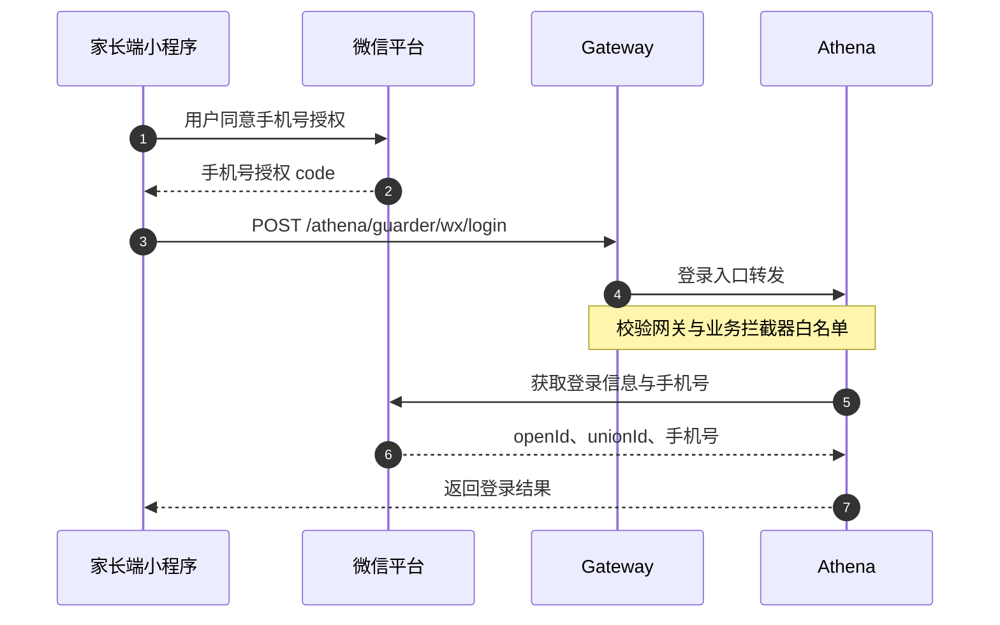

# 图表可视化 / Diagram viewer

为 **DSH 0.2.2-rc.3** 开发的独立插件，把聊天里的 Mermaid 代码块显示为矢量图，不修改 DSH 安装文件或会话正文。

## 使用

安装并启用后，消息中的 `mermaid`（或 `mmd`）代码块默认呈现图表。切换“源码”可查看、复制原始代码。

````markdown

````

- 支持 Mermaid 内置图表类型，包括时序图、流程图、类图、状态图、ER 图、甘特图等。为防止外部资源请求，不支持 `@{…}` 形状元数据（含图片或图标）；请使用 `A[节点]` 等传统节点语法。
- 默认按原生比例显示，避免把文字压缩成不可读的小字；宽图横向滚动，长图使用“展开”。“适宽”用于查看全貌，`− / +` 调整细节，百分比按钮恢复 100%。
- 以低饱和蓝色区分主要结构，弱化辅助线，使用暖色注释；自动跟随 DSH 浅色/深色主题。
- 消息生成中展示原代码，结束后排版。语法错误显示原因、原代码及“重试”，不会让整条消息消失。
- 未标记语言的普通代码块不会被接管；请在代码围栏后标记 `mermaid`。只作用于聊天 Markdown 扩展点，不改写文件预览或侧边聊天自己的 Markdown 渲染器。

## 安全与边界

本机页面打包 Mermaid 12.3.0 和 DOMPurify 3.4.18，无 CDN、外部图表服务或会话数据上传。图内初始化指令及 YAML frontmatter 配置被忽略，使用统一主题。不开启链接、回调或外部图片；内联 SVG 经清洗，CSS 规则限定在自身图形 ID 下。为阻止清洗前的资源请求，暂不支持 `@{…}` 元数据及 `classDef`、`style`、`linkStyle` 自定义 CSS；请使用传统节点和插件统一主题。

输入上限 48,000 字符、流程图最多 700 条边，输出上限 2.5 MB；超限保留源码并提示拆图。这些限制不是主线程布局的硬超时，特别复杂的图仍可能耗时。首次使用需初始化渲染引擎；客户端单包较大，但不重复安装 React。

当前验证范围以本次开发报告为准。没有连接页面控制工具时，构建和原生扩展点注册验证不能代替实际视觉验收。

## 开发

在仓库根目录使用 Node.js 24+ 和 pnpm 11：

```sh
pnpm --dir dsh-diagrams install --frozen-lockfile --ignore-scripts
pnpm --dir dsh-diagrams build
pnpm --dir dsh-diagrams test
```

[客户端产物](<client.bundle.js>)应与源码一起分发。无安装脚本及生产运行依赖；第三方代码已打包，许可证原文及源码获取声明见 [THIRD_PARTY_NOTICES.md](<THIRD_PARTY_NOTICES.md>)。其中 ELK/elkjs 0.12.1 的对应源码和构建脚本可从 [elkjs 0.12.1](https://github.com/kieler/elkjs/tree/624ae90aa37110033a8af59c5ccbb292708b4317) 与 [ELK v0.12.1](https://github.com/eclipse-elk/elk/tree/3aa3b9fb98d8f9a41285b3061cff5efe79ed2ba4) 获取；各第三方组件的许可证仅适用于其各自代码。

在 DSH 的插件安装入口选择本目录，或让智能体调用 `plugin_manager install_bundle` 安装绝对路径。安装影响当前 profile 的全部会话；以管理器的 `application` 和 `warnings` 为准，必要时刷新或重启。尚未发布到仓库现有 Release。
